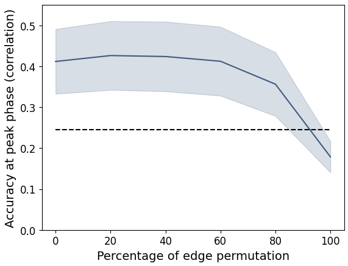
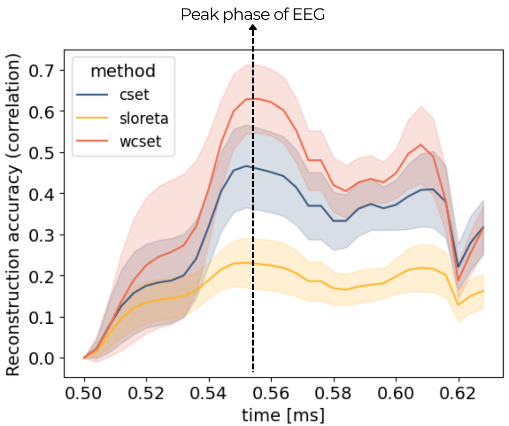

# Introduction

Source reconstruction is an ill-posed problem whose reliability depends on how well the prior reflects neural physiology. Classical Bayesian methods assume independent, Gaussian-distributed sources based on Occam’s Razor, an assumption underlying sLORETA, eLORETA, beamformers, and dSPM. Yet neural sources interact, and independence priors fail to capture this structure. Attempts to include source interactions—such as using fMRI-derived covariance matrices @liu_fmri-si-stbf_2021 or estimating the covariance jointly with the sources @gonzalez-moreira_caulking_2018 —either suffer from modality mismatch or greatly increase model complexity, and have rarely been tested on interacting sources.

A recent approach, Connectome Spectrum Electromagnetic Tomography (CSET) @ruequeralt_connectome_2024, uses insights from connectomics, which represents the brain as a graph whose nodes are regions and edges are white-matter connections. Using the graph Fourier transform (GFT), brain activity can be decomposed into graph harmonics, and prior work has shown that these signals are compact in the GFT domain. CSET exploits this compactness by reconstructing activity in Fourier space with a sparse prior.

We propose an extension of CSET that selectively weights the most informative graph harmonics. Our analyses indicate that certain harmonics consistently contribute more to accurate reconstruction. We incorporate harmonic-specific weighting within a Gaussian prior, which preserves compactness and enables efficient optimization.

To evaluate the method, we developed a simulation framework for interacting sources. Beyond single-source localization, we assess performance on complex, interconnected patterns and show that connectivity-informed priors can improve reconstruction of structured neural dynamics.

# Methods

To generate interactive source simulations, we define a functional model similar to classic approaches and incorporate a connectome to structurally constrain the flow of information.

We selected a sample subject from the Vepcon dataset [ref] (sub-10), which provides a T1-weighted MRI used to build the head model (brain, inner-skull, outer-skull, and outer-skin surfaces) using FreeSurfer v. A  template was added, cheek electrodes were removed (final count: ), and the montage was coregistered to the subject’s outer-skin surface using MNE-Python v.

Using MNE-Python, we uniformly sampled ~6000 dipoles on the cortical surface, removed dipoles on the medial wall (where no grey matter is present), and fixed orientations to the cortical surface normals. The forward matrix was computed with a boundary element model using conductivities of  (brain),  (skull), and  (skin). To avoid the inverse crime, we used a forward solution for reconstruction where conductivities were decreased by 10%.

The dataset also provides a tractogram obtained from diffusion weighted images. We removed tracts not terminating in grey matter and mapped streamline endpoints to their nearest dipoles using scikit-learn’s nearest-neighbor algorithm, yielding a source-space connectome. Because tractography underestimates local grey-matter connectivity, we added local connections by linking each dipole to neighbors within 10 mm.

To simulate brain activity, we select a seed region typically containing 5–10 dipoles according to the parcellation used in the MultiConn atlas @aleman-gomez_multi-scale_2022. This region carries the initial waveform $S_0$ (see Figure 1.A). Using fiber lengths between connected dipoles, we estimate propagation delays based on axonal conduction speed and a synaptic/inter-processing delay (formula in Figure 1.A). Each dipole receives a delayed and attenuated version of the source signal, decayed by $\gamma$, from every upstream source. Signals from different sources are superposed, producing a feedforward propagation pattern shaped by the connectome.

Pink noise (scale:  ) is added to the dipole activity. We project the signal to electrodes using the forward matrix and compute the peak-to-baseline SNR. The activity is then scaled to reach a target peak-to-baseline SNR of  , re-projected, and contaminated with white noise (scale:  $). The resulting EEG contains a spike whose rising phase already reflects substantial source spread, making localization challenging at the peak.

Reconstruction is performed using the slightly altered forward model. We compare three methods: sLORETA, CSET, and our weighted-CSET (wCSET). Accuracies are evaluated by measuring the spatial correlation between a reconstruction and the ground truth at a given time point.

# Results

The first study we perform, was to check the ability of CSET to reconstruct while having erroneous connections in the connectome during reconstruction only. For that, we simulate using the ideal connectome and then permute X% of the connections before applying reconstruction. A permutation consists in taking a connection and putting it somewhere else in the graph. Figure 2.A shows the average spatial correlation at the EEG peak phase under various levels of perturbation applied to the connectome. The plot shows that the accuracy remains stable (correlation of 0.4) until approximately 0.6 permutation (i.e., 60% of the connections have been permuted), after which it decreases until around 0.2, where the connectome becomes essentially random and no longer resembles the one used to generate the simulations. The correlation observed at 0.2 matches the accuracy of sLORETA during the peak phase, which does not rely on any connectivity information. As discussed in the conclusion, this result motivated a redesign of the prior used in CSET.

In Figure 2.B, the curves represent the spatial correlation between the reconstruction (sLORETA, CSET, or wCSET) and the ground truth at each time point. The time window focuses on activity around the EEG spike. The correlation is initially low because early activity is highly focal, so most brain regions contain only noise that does not correlate with the ground truth and biases the overall measure downward. The correlation then increases as activity propagates across the brain, and finally decreases again after the spike. For both CSET and wCSET, the peak correlation is higher than that of sLORETA.

::: {#fig-2 layout-ncol=2}

{#fig-Reconstruction robustness of CSET}
{#fig-Test2}

*Reconstruction accuracy*. A) Spatial correlation with ground truth for the methods CSET, sLORETA and wCSET over time. The correlation starts low since the activity is very focal at the start and the brain activity is mostly noise which results in a bad correlation. At the EEG peak phase, all methods show increase correlation, since the activity pattern covers more brain area, but wCSET tops the results followed by CSET and sLORETA. B) Correlation of CSET with ground truth at peak phase for different levels of connectome perturbations.

:::

# Conclusion

Figure 2.A shows that the CSET method is highly robust. Even after permuting half of the connections, enough connectivity information remains for the reconstruction accuracy to stay nearly unchanged. By examining the graph Fourier harmonics of the original connectome and the 50%-perturbed connectome, we observed that the low and high harmonics remain similar, whereas the intermediate harmonics change substantially. This phenomenon has been described in previous literature, where the robust low-frequency harmonics are referred to as integrative, the robust high-frequency harmonics as segregative, and the sensitive intermediate harmonics as degenerative. The same studies relate the robustness of harmonics to the gap spectrum, which quantifies the frequency difference between consecutive harmonics. The literature suggests that integrative harmonics are useful for describing integrative activity (such as spike propagation across the brain), while segregative harmonics are better suited for representing localized activity (such as source onset). Graph Fourier transforms are also typically shown on a log–log scale because most of the energy in the spectral domain is concentrated in the low-frequency harmonics, further highlighting their importance.

These observations lead us to believe that the integrative and segregative harmonics contribute most effectively to activity reconstruction. Based on this, we designed a new optimization problem in which the prior remains the Fourier transform but each harmonic is weighted according to the gap spectrum, which closely follows the robustness profile of the harmonics, hence the name weighted-CSET. While CSET seeks to reconstruct a sparse connectome spectrum and thereby introduces compactness, wCSET explicitly builds a compact spectrum by favoring integrative and segregative harmonics and down-weighting degenerative harmonics. 

We then tested wCSET across the full EEG time window and compared it with sLORETA and CSET. In Figure 2.B., spatial correlation at early times is low because the signal is highly focal and much of the brain is dominated by noise, which biases the correlation measure. In future work, we plan to compute precision and recall to mitigate this bias. Nevertheless, for the purposes of this abstract, differences in correlation between methods can still be interpreted as indicators of relative performance. Before the 50% rising phase of the spike, the correlations across methods are relatively similar. During the EEG peak, correlations increase for all methods, as the spatial extent of the signal is larger and therefore easier to capture. Notably, CSET and wCSET perform substantially better at this stage, which is expected: as the activity propagates, the underlying sources become more interconnected, so connectivity-driven priors provide a stronger advantage. wCSET's strategy seems to further improve reconstruction performance.

Overall, this simulation study shows promising potential for extending source imaging from simple source localization toward full reconstruction of source activity patterns by reconstructed the connectome spectrum and hence adding structural connectivity a-priori information. As a next step, we aim to design an in-vivo paradigm that allows evaluation of connectivity-driven reconstruction methods. Many paradigms exist for which the relevant connectivity is well documented in the literature; the remaining challenge is to develop effective ways of evaluating reconstruction quality within these paradigms.
