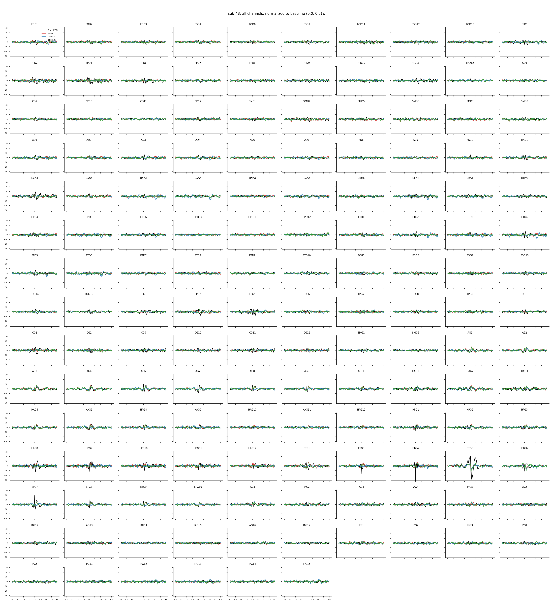

# 1. Environment & Data Acquisition

## Data Procurement

## Computational Environment

To run all the code in this manuscript, you will need the following softwares:
- FreeSurfer
- Simnibs
- python
- git
- yq
We recommend you build a virtual environment for the python framework using conda. It is important that you use python version 3.10 as it is the newest python version that let's all the used dependencies coexist. The virtual environment should then contain the mindmap package, specificaly designed to hold any functions related to this project.
```bash
cd ~/location/for/mindmap/package
git clone githublink

cd ~/location/for/manuscript/project
git clone githublink

conda create -n <env-name> python=3.11
conda activate <env-name>
pip install .
```
You should now be ready to run anything that comes ahead.

✅ **Fixed:** every cell below used to call `dm.build_path(...)`, which
doesn't exist on `IntraManager`/`mm.io.DatasetManager` (only `get_path`
does, confirmed in `mindmap/io/dataset.py` and `scripts/data_manager.py`,
and consistent with how both sibling files - `processing_spike.qmd`,
`processing_simf.qmd` - call it). This would have raised `AttributeError` on
the first call in every cell. All occurrences in this file have been renamed
to `dm.get_path(...)`.

This runs the pipeline validating source reconstruction against real
**intracranial** EEG recorded simultaneously with scalp EEG (a small cohort,
unlike the large SPIKE cohort or the single-subject SIMF study) - the
"ground truth" here is real intracranial activity, not a resection or a
simulated source.

# 2. Signal Processing (Electrophysiology)

## Scalp EEG Conditioning

Preprocesses the scalp EEG recorded concurrently with intracranial EEG.
Unlike the SPIKE study's spike-triggered averages, this is closer to a
standard evoked-response pipeline: average reference, baseline correction,
then an **empirical** noise covariance estimated directly from the data
(possible here because, unlike SPIKE, the input isn't already
pre-averaged).

**Parameter choices:**

- `baseline = [0, 1.5]` (s): same window used for both baseline correction
  and the noise covariance's `tmax` below. **FILL**
- `ref_channels = "average"`: same average-reference choice as
  `processing_spike.qmd`/`processing_simf.qmd` - **FILL** applies
  consistently across all three files.
- `mne.compute_covariance(eeg, tmax=1.5, method="empirical")`: empirical
  (sample) covariance rather than a shrinkage/regularized estimator (e.g.
  `"shrunk"`, `"auto"`). **FILL**

```{python filename="eeg_preprocessing.py"}
# | output: false

from pathlib import Path
from scripts.utils import loop, check_files
from scripts.data_manager import IntraManager

# data manager
dm = IntraManager("intra.config.yml")

# report folder
report_dir = Path("./reports/")
report_dir.mkdir(exist_ok=True)

@loop(subjects=dm.subjects)
def process_eeg(sub, overwrite):
    # ouput files
    fave = dm.get_path(sub, "ave", task="spk")
    fcov = dm.get_path(sub, "cov", task="spk")

    if check_files([fave, fcov]) and not overwrite:
        return

    # 0. Load data
    eeg = dm.load(sub, "eeg", task="spk")

    # 1. Process EEG
    eeg = eeg.set_eeg_reference(ref_channels="average", projection=True) # Average referencing
    eeg = eeg.apply_baseline(baseline=[0,1.5])                           # Apply baseline correction
    ncov = mne.compute_covariance(eeg, tmax=1.5, method="empirical")     # Noise covariance
    ave = eeg.average()                                                  # averaging

    # 2. save
    ave.save(fave, overwrite=overwrite)
    ncov.save(fcov, overwrite=overwrite)

    # 3. Make a report
    mm.viz.build_preprocessing_report(
        ave, ncov, subject_id=sub, fname=report_dir/f"sub-{sub}_desc-intra_ave.html",
    )

process_eeg(overwrite=False)
```


## iEEG Ground Truth Preparation

Builds the intracranial "ground truth" evoked response each method's
projected virtual iEEG (`estimate_ieeg.py`, further down) is later
compared against. Just averages the epochs directly - no filtering or
referencing shown here, so this assumes the intracranial data arrives
already clean. **FILL** (confirm no upstream cleaning step is expected
before this point)

```{python filename="ieeg_preprocessing.py"}
# | output: false

from pathlib import Path
from scripts.utils import loop, check_files
from scripts.data_manager import IntraManager

# data manager
dm = IntraManager("intra.config.yml")

# report folder
report_dir = Path("./reports/")
report_dir.mkdir(exist_ok=True)

@loop(subjects=dm.subjects)
def process_ieeg(sub, overwrite):
    # Output files
    fiave = dm.get_path(sub, "i-ave", task="spk")

    if check_files([fiave]) and not overwrite:
        return

    # 0. Load data
    ieeg = dm.load(sub, "ieeg", task="spk")

    # 1. Process iEEG
    iave = ieeg.average() # averaging

    # 2. save
    iave.save(fiave, overwrite=overwrite)

process_ieeg(overwrite=False)
```


# 3. Anatomical & Forward Modeling

## MultiConn Parcellation

New section, added so `connectivity.py` below can build an
atlas-based connectome the same way `processing_spike.qmd` does - this
parcellation didn't exist for the INTRA cohort before. Same tool, same
parameter values as the other two files' `MultiConn_parcellation.py`.

**Parameter choices:**

- `margin = 2` (mm), `thresh = 0.05`, `scale = "4"`: same values as
  `processing_spike.qmd`/`processing_simf.qmd`. **FILL** (see the same note
  in those files)

```{python filename="MultiConn_parcellation.py"}
# | output: false

import mindmap as mm
from scripts.utils import loop, check_files
from scripts.data_manager import IntraManager

overwrite = False

# data manager
fconfig = "intra.config.yml"
dm = IntraManager(fconfig)

@loop(subjects=dm.subjects)
def generate_multiconn_parcellation(sub, overwrite):
    # output files
    entities = dict(segmentation="multiconn2022", scale="4")
    fseg = dm.get_path(sub, "dseg", **entities)
    fclut = dm.get_path(sub, "dseg", extension=".txt", **entities)

    if check_files([fseg, fclut]) and not overwrite:
        return

    # 1. Run the MultiConn parcellation pipeline
    multiconn = mm.anatomy.parcellation.parcellate_multiconn(
        sub = sub,
        fconfig = fconfig,
        margin = 2,       # White matter extension in [mm]
        thresh = 0.05,    # Probability threshold to discretize thalamus atlas
        verbose = 1,
    )

    # 2. Save data
    multiconn.save(
        fseg,
        fclut,
    )

generate_multiconn_parcellation(overwrite=False)
```

## Cortical Surface Modeling (FreeSurfer)

Same as `processing_spike.qmd`'s `brain_surface_reconstruction.py`: runs
FreeSurfer's default `recon-all -all` per subject, no custom flags. See that
file's note.

```{python filename="brain_surface_reconstruction.py"}
%%bash
bash scripts/fsrecon.sh intra.config.yml
```

Builds each subject's cortical source space and removes the medial wall -
identical cell (same filename, same code) to `processing_spike.qmd`'s
`setup_source_space.py`.

**Parameter choices:**

- `spacing = "oct6"`, `surface = "white"`, `add_dist = True`, `n_jobs = 10`:
  same values as the other two files. **FILL** (see the same note in
  `processing_simf.qmd`/`processing_spike.qmd`)

```{python filename="setup_source_space.py"}
# | output: false

import mne
import mindmap as mm
from scripts.utils import loop, check_files
from scripts.data_manager import IntraManager

# data manager
dm = IntraManager("intra.config.yml")

@loop(subjects=dm.subjects)
def setup_source_space(sub, overwrite):
    # output files
    fsrc = dm.get_path(sub, "src")

    if check_files([fsrc]) and not overwrite:
        return

    # 0. Load data
    vtx_ctx = dm.load(sub, "vertex-ctx")   # vertices in cortex (omits medial wall)

    # 1. Setup source space
    source_space = mne.setup_source_space(
        subject = f"sub-{sub}",
        spacing = "oct6",    # sampling mehtod (influences dipole spacing)
        surface = "white",
        add_dist = True,
        subjects_dir = dm.roots["fs"],
        n_jobs = 10,
        verbose = "warning"
    )

    # 2. Remove medial wall
    source_space = mm.anatomy.source_space.filter_dipoles_by_id_list(source_space, vtx_ctx)

    # 3. Save
    source_space.save(fsrc, overwrite=overwrite, verbose="warning")

setup_source_space(overwrite=False)
```


## Tissue Segmentation & Mesh Generation (SimNIBS)

Same CHARM segmentation + BEM layer construction as
`processing_spike.qmd`'s `head_segmentation.py`.

**Parameter choices:**

- `n_smooth = 20`: same value as the other two files. **FILL**

```{python filename="head_segmentation.py"}
# | output: false

import mindmap as mm
from scripts.utils import loop, check_files
from scripts.data_manager import IntraManager

# data manager
dm = IntraManager("intra.config.yml")

# segment head
@loop(subjects=dm.subjects)
def segment_head(sub, overwrite):
    # output file
    fseg = dm.get_path(sub, "seg")
    fbem = dm.get_path(sub, "bem")

    # ---------------------
    # Tissue segmentation
    # ---------------------

    # input files
    ft1 = dm.get_path(sub, "T1w")

    # 1. run charm pipeline
    mm.anatomy.segmentation.run_charm(
        sub,
        ft1,
        charm_dir = dm.roots["charm"],
        overwrite = overwrite,
    )

    # ----------------
    # Mesh generation
    # ----------------

    # 0. Load data
    seg = dm.load(sub, "seg")             # charm segmentation
    ras2tkras = dm.load(sub, "ras2tkras") # ras to tkras transform
    vol_info = dm.load(sub, "vol-info")   # volume information (to save surfaces in FreeSurfer format)
    bem_labels = dm.get_bem_labels()      # charm labels needed for each BEM layer

    # 1. Build BEM layers from CHARM segmentation
    layers = mm.anatomy.forward.build_bem_layers(seg, bem_labels, n_smooth=20)
    layers = mm.anatomy.forward.bem_transform(layers, ras2tkras)

    # 2. save layers in freesurfer/{subject}/bem
    folder = dm.roots["fs"]/f"sub-{sub}"/"bem"
    folder.mkdir(exist_ok=True)
    mm.anatomy.forward.save_bem_as_freesurfer(folder, layers, vol_info, overwrite=True)

segment_head(overwrite=False)
```


## Lead Field Computation

Computes a single forward solution per subject - same conductivity values
and same `ico=None` constraint as `processing_spike.qmd`'s
`forward_problem.py`.

**Parameter choices:**

- `conductivity = [0.3, 0.006, 0.3]` S/m: same as the SPIKE/SIMF studies.
  **FILL** (see the same note in the other two files)
- `ico = None`: forced by the same MNE/`tris` compatibility issue - not a
  free choice.

```{python filename="forward_problem.py"}
# | output: false

import mne
import mindmap as mm
from scripts.utils import loop, check_files
from scripts.data_manager import IntraManager

# data manager
dm = IntraManager("intra.config.yml")

# solver forward problem
@loop(subjects=dm.subjects)
def compute_fwd(sub, overwrite):
    # output files
    ffwd = dm.get_path(sub, "fwd")

    if check_files([ffwd]) and not overwrite:
        return

    # 0. Load data
    ave = dm.load(sub, "ave", task="spk")    # EEG for channel positions
    trans = dm.load(sub, "eeg-trans")        # EEG to ras transformation
    src = dm.load(sub, "src")                # Source space

    # 1. assemble BEM
    model = mne.make_bem_model(
        subject = f"sub-{sub}",
        subjects_dir = dm.roots["fs"],
        conductivity = [0.3, 0.006, 0.3],
        ico = None,     # ico=None is forced because 'tris' mismatch with MNE
        verbose = "warning",
    )

    bem = mne.make_bem_solution(model)

    # 2. Compute forward solution
    forward = mne.make_forward_solution(
        info = ave.info,
        trans = trans,
        src = src,
        bem = bem,
        meg = False,
        eeg = True,
        verbose = "warning",
    )

    # 3. save solution
    mne.write_forward_solution(ffwd, forward, overwrite=overwrite, verbose="warning")

compute_fwd(overwrite=False)
```


# Connectomics

## Build atlas-based connectivity graph and compute its eigensystem

Changed to match `processing_spike.qmd`'s `connectivity.py`: builds
each subject's connectome from the population probabilistic tractography
atlas (`REF_CON`, newly added to `intra.config.yml` - see its note), with a
geometry-based fallback for gaps, instead of the previous geometry-only
approach - this cohort doesn't have individual diffusion MRI either (same
situation as SPIKE), so the population atlas is used here too.

**This produces new output files (`atlas="probcon"`) rather than
overwriting the old geometry-only ones (`desc="geom"`)** - both versions now
coexist on disk, so nothing from the previous approach is lost and this is
easy to revert (just point consumers back at the `desc="geom"` files).
⚠ **`solve_inverse.py` still loads the old `desc="geom"` eigensystem**
(`eig = dm.load(sub, "eig", desc="geom")`) - it hasn't been switched to the
new `atlas="probcon"` one, since that's a separate decision about which
connectome to actually use for reconstruction, not part of this change.

**Parameter choices:** identical to `processing_spike.qmd`'s
`connectivity.py` - `consistency > 65`, `sparsity = 0.14`,
`deterministic = True`, `maximum_dist = 22`, `maximum_neigh = 35`,
`lap_type = "normalized"`. **FILL** (see that file's notes - same questions
apply here). Same for `beltrami`: no free parameters at all
(`compute_beltrami_harmonics(src)` takes only the source space itself) -
see `processing_spike.qmd`'s `connectivity.py` prose for the full
construction rationale.

```{python filename="connectivity.py"}
# | output: false

import numpy as np
import mindmap as mm
from scripts.utils import loop, check_files
from scripts.data_manager import IntraManager

# data manager
dm = IntraManager("intra.config.yml")

# --- process atlas ---
probcon = dm.load_ref("REF_CON")

consistency = probcon["matrices"]["consistency"][:,:]
length = probcon["matrices"]["length"][:,:]
number = probcon["matrices"]["numbStlines"][:,:]

# Correct NaNs to 0
consistency = np.nan_to_num(consistency)
length = np.nan_to_num(length)
number = np.nan_to_num(number)

atlas = np.bitwise_and(
    consistency > 65,
    length > 0,
)
atlas = np.bitwise_and(
    atlas,
    number > 0,
)

atlas = length * atlas  # weight = avg fiber lengths

# --- build atlas-based connectivity matrix ---
@loop(subjects=dm.subjects)
def build_connectivity(sub, overwrite):
    # output files
    fcon = dm.get_path(sub, "con", atlas="multicon")
    feig = dm.get_path(sub, "eig", atlas="multicon")
    feig_beltrami = dm.get_path(sub, "eig", desc="beltrami")

    src = dm.load(sub, "fwd")["src"]

    if check_files([fcon, feig]) and not overwrite:
        pass
    else:
        # Start: Load data
        parc = dm.load(sub, "dseg", segmentation="multiconn2022", scale="4")
        ras2tkras = dm.load(sub, "ras2tkras")

        # 1. Generate atlas-based connectivity
        con_atlas = mm.analysis.connectivity.connectome_from_atlas(
            src, parc, atlas, ras2tkras,
            sparsity = 0.14,
            deterministic = True,
        )

        # 2. Generate geometry-based connectivity
        con_geom = mm.analysis.connectivity.connectome_from_geometry(
            src,
            maximum_dist = 22,
            maximum_neigh = 35,
            weights = True,
        )

        # 3. Fuse connectivities
        con = con_atlas.copy()
        fill_idx = np.argwhere((con_geom > 0) & (con_atlas == 0))
        con[fill_idx[:,0], fill_idx[:,1]] = con_geom[fill_idx[:,0], fill_idx[:,1]]
        con = (con > 0).astype(float)

        # 4. Compute Spectral properties: shared helper (dense eigh,
        # eigval[0] pinned to exactly 0), matches processing_simf.qmd's
        # connectivity cells - both now compute the spectrum the same way
        inv_con = np.divide(1, con, out=np.zeros_like(con), where=con>0)    # weight according to length
        eigvec, eigval = mm.analysis.connectivity.compute_cst(inv_con)

        # End: Save
        np.save(fcon, con)
        mm.core.write_eig(feig, eigvec, eigval)

    # 5. Beltrami harmonics: pure cortical-shape eigenbasis, no connectivity
    # matrix involved at all - same recipe as processing_simf.qmd's
    # surrogate_connectivity.py / processing_spike.qmd's connectivity.py.
    # Checked/computed independently of the atlas/geometry connectome above
    # (this cell runs with overwrite=False, so subjects already processed
    # before this step existed must not skip past it via the early exit
    # above).
    if not (check_files([feig_beltrami]) and not overwrite):
        eigvec_beltrami, eigval_beltrami = mm.anatomy.source_space.compute_beltrami_harmonics(src)
        mm.core.write_eig(feig_beltrami, eigvec_beltrami, eigval_beltrami)

build_connectivity(overwrite=True)
```


# Inverse problem

## Solve inverse problem

Runs all six source reconstruction methods (wCSET, CSET, sLORETA, dSPM,
wMNE, beltrami), matching `processing_spike.qmd`'s `solve_inverse.py` - CSET was
previously missing (only a commented-out, already-broken leftover line
referenced it: `#fcset = sr.get_path(...)`, using an undefined `sr`
variable from an older version of this code; deleted rather than fixed,
since the working pattern from `processing_spike.qmd` replaces it anyway).

⚠ MCE excluded from every study in this project (not solved, saved, or
scored anywhere) - see `processing_spike.qmd`'s `solve_inverse.py` prose and
`index.qmd`'s `plot_configuration.py` note for the full rationale.

⚠ **Solver setup brought in line with `processing_simf.qmd`'s
`solve_inverse.py`** (the project's now-current convention - see
`processing_spike.qmd`'s own `solve_inverse.py` prose for the full
rationale, applied identically here). Recomputing STCs under this new setup
means `estimate_ieeg.py`/`evaluate_vieeg_fidelity.py` further down are now
stale against them and need re-running once the new STCs exist.

⚠ **`mne`/`MNE` renamed to `wmne`/`wMNE` throughout** (this file, and
`processing_simf.qmd`/`processing_spike.qmd`/`index.qmd`) - see
`processing_spike.qmd`'s own `solve_inverse.py` prose for the full
rationale: MNE-Python's `method="MNE"` is only "plain" MNE without depth
weighting, so once a depth prior is applied the result is *weighted* MNE
(wMNE), and it needs its own depth-weighted inverse operator rather than
sharing sLORETA/dSPM's `depth=None` one.

**Parameter choices** (matching `processing_simf.qmd`'s `solve_inverse.py`):

- `lambda2 = max(0.01, 1/snr**2)`: same floor as `processing_spike.qmd`,
  shared by dSPM/sLORETA/wMNE/wCSET. **FILL** (why this specific floor)
- CSET's `lambda2` and `depth` are fixed at `0.1` and `0.2` respectively,
  decoupled from the SNR-derived value above, per explicit instruction -
  superseding the earlier `lambda2=1`/`depth=0.8` - same as
  `processing_spike.qmd`, see that file's prose for the
  `lambda2-tuning.ipynb` sweep the earlier `lambda2=1` came from; the new
  values are a deliberate override, not re-derived from that sweep.
- `depth = 0.8` for wMNE, `depth = 0.2` for CSET and wCSET (per explicit
  instruction, superseding wCSET's earlier `depth=0.5`), and `depth = None`
  (no depth weighting) for `mne.minimum_norm.make_inverse_operator` shared
  by sLORETA/dSPM - previously `0.8` for wCSET/CSET/wMNE alike (wMNE
  sharing one operator with sLORETA/dSPM); wMNE now gets its own separate,
  depth-weighted operator instead, at `0.8` - the standard/recommended
  depth-weighting exponent for wMNE (MNE-Python's own default, and the
  value found near-optimal in Lin et al. 2006's original depth-weighting
  paper), no longer tied to CSET/wCSET's own `depth`, both of which have
  since moved to `0.2`.
- `harm = 5`, `harmonic_method = "lowpass"` (wCSET's harmonic weighting) -
  restored after a typo briefly set it to `harm = 0.5` instead (itself
  previously `harm = 0.7` with the default `"gap"` method, before the
  `harmonic_method = "lowpass"` switch).
- `noise_norm` dropped from the wCSET call - it was only ever set to
  `None`, its own class default, and isn't passed in
  `processing_spike.qmd`'s equivalent call either; removed for consistency,
  no behavior change.
- `fixed = True`: same as `processing_spike.qmd`. **FILL**
- **`beltrami`**: wCSET on the Laplace-Beltrami mesh eigenbasis
  (`connectivity.py`'s new step 5 above) instead of the structural
  connectome, using a different harmonic-weighting mechanism from the other
  five methods: `depth = 0`, `harmonic_method = "logpass"`, `cutoff = 150`,
  no `harm=` - same as `processing_spike.qmd`'s `solve_inverse.py`, see that
  file's prose for the full GBF-paper rationale (Wang et al. 2026, *Nat
  Biomed Eng*) and why `cutoff=150` (tuned on the simulation study's own
  mesh, reused here as-is). `lambda2` is the same SNR-derived value shared
  by dSPM/sLORETA/wMNE/wCSET above, not CSET's fixed `0.1`.

```{python filename="solve_inverse.py"}
# | output: false

import mne
import mindmap as mm
from scripts.utils import loop, check_files
from scripts.data_manager import IntraManager

# data manager
dm = IntraManager("intra.config.yml")

# apply inverse solvers
@loop(subjects=dm.subjects)
def source_recon(sub, overwrite=True):
    # outputs files
    fwcset = dm.get_path(sub, "stc", task="spk", desc="wcset")
    fcset = dm.get_path(sub, "stc", task="spk", desc="cset")
    fsloreta = dm.get_path(sub, "stc", task="spk", desc="sloreta")
    fdspm = dm.get_path(sub, "stc", task="spk", desc="dspm")
    fwmne = dm.get_path(sub, "stc", task="spk", desc="wmne")
    fbeltrami = dm.get_path(sub, "stc", task="spk", desc="beltrami")

    if check_files([fwcset, fcset, fsloreta, fdspm, fwmne, fbeltrami]) and not overwrite:
        return

    # 0. Load data
    fwd = dm.load(sub, "fwd")                    # forward solution
    ave = dm.load(sub, "ave", task="spk")        # averaged EEG
    ncov = dm.load(sub, "cov", task="spk")       # EEG noise covariance
    eig = dm.load(sub, "eig", atlas="multicon")  # Connectome eigensystem
    eig_beltrami = dm.load(sub, "eig", desc="beltrami")  # Laplace-Beltrami mesh eigensystem

    # 1. Estimate regularizer parameter
    snr, _ = mm.analysis.eeg.estimate_evoked_snr(ave, baseline=(0,1.5), noise_cov=ncov)
    snr = snr.max()
    lambda2 = 1.0 / (snr**2)

    print(f"Estimated SNR: {snr:.3f}")
    print(f"Estimated lambda2: {lambda2:.3f}")

    lambda2 = max(0.01, lambda2)

    # TEMP HACK (revert later): force lambda2=0.01 for wCSET/beltrami only,
    # test requested out-of-band - doesn't touch the SNR-derived `lambda2`
    # above, still shared by CSET's fixed 0.1 / sLORETA / dSPM / wMNE.
    lambda2_hack = 0.01

    # ---------------------------------
    # 2. Run source reconstructions <3
    # ---------------------------------

    # 2.1 wcset
    inv = mm.analysis.inverse.wCSET(
        forward = fwd,
        noise_cov = ncov,
        depth = 0.2,                # depth weighting
        eigenvectors = eig["vec"],
        eigenvalues = eig["val"],
        harm = 5,                   # harmonic weighting
        harmonic_method = "lowpass",
    )
    wcset = inv.solve(ave, lambda2_hack)

    # 2.2 CSET
    inv = mm.analysis.inverse.CSET(
        forward = fwd,
        noise_cov = ncov,
        depth = 0.2,
        eigenvectors = eig["vec"],
    )

    # fixed, decoupled from the SNR-derived lambda2 above - see prose
    cset = inv.solve(ave, lambda2=0.1)

    # 2.3 sLORETA
    inv = mne.minimum_norm.make_inverse_operator(ave.info, fwd, ncov, depth=None, fixed=True)
    sloreta = mne.minimum_norm.apply_inverse(ave, inv, lambda2, method="sLORETA")

    # 2.4 dSPM
    dspm = mne.minimum_norm.apply_inverse(ave, inv, lambda2, method="dSPM")

    # 2.5 wMNE - own inverse operator (depth=0.8, no longer matching CSET/wCSET's own depth=0.2), not
    # shared with sLORETA/dSPM's depth=None one - see prose above
    inv_wmne = mne.minimum_norm.make_inverse_operator(ave.info, fwd, ncov, depth=0.8, fixed=True)
    wmne = mne.minimum_norm.apply_inverse(ave, inv_wmne, lambda2, method="MNE")

    # 2.6 beltrami - wCSET on the Laplace-Beltrami mesh eigenbasis, GBF
    # paper's log-form spectral prior (Wang et al. 2026, Nat Biomed Eng)
    # rather than the connectome wCSET's exponential lowpass prior above -
    # see prose above
    inv = mm.analysis.inverse.wCSET(
        forward = fwd,
        noise_cov = ncov,
        depth = 0,                        # paper-faithful: no depth term
        eigenvectors = eig_beltrami["vec"],
        eigenvalues = eig_beltrami["val"],
        harmonic_method = "logpass",
        cutoff = 150,
    )
    beltrami = inv.solve(ave, lambda2_hack)

    # 3. Save
    wcset.save(fwcset, overwrite=overwrite, verbose="warning")
    cset.save(fcset, overwrite=overwrite, verbose="warning")
    sloreta.save(fsloreta, overwrite=overwrite, verbose="warning")
    dspm.save(fdspm, overwrite=overwrite, verbose="warning")
    wmne.save(fwmne, overwrite=overwrite, verbose="warning")
    beltrami.save(fbeltrami, overwrite=overwrite, verbose="warning")

source_recon(overwrite=True)  # must force-regen: CSET now depth=0.2/lambda2=0.1 (was depth=0.8/lambda2=1), wCSET's harm was mistakenly set to 0.5, now fixed to the intended harm=5 (depth=0.2 unaffected, unchanged from the prior run), wMNE renamed from mne with its own depth-weighted operator, and a new 6th method "beltrami" added (wCSET on the Laplace-Beltrami mesh eigenbasis, GBF paper's logpass/cutoff=150 mechanism)
```


# Virtual intracranial-EEG

## Project source images to intracranial channels

Projects each method's source estimate onto virtual intracranial electrode
positions, so it can be compared directly to the real intracranial recording
(`i-ave`) from the ground-truth-preparation step above - this is the actual
validation step this whole study exists for. Now covers all five methods
computed by `solve_inverse.py` (`wcset, cset, sloreta, dspm, wmne`) -
previously only 4 of them were projected here.

**Parameter choices (`compute_virtual_ieeg`):**

- `conductivity = 0.25` S/m: infinite homogeneous-space conductivity used
  for the point-source-to-electrode projection. Taken from Grova et al.
  (2016), who lower it from the usual 0.33 S/m following Cosandier-Rimele
  et al. (2007): the infinite-medium model slightly underestimates the
  potential compared with a three-shell model, and 0.25 S/m compensates.
  It only enters as a global 1/σ scale factor, so it has no effect on any
  correlation-based metric computed below (hence not mentioned in the
  manuscript).
- `threshold = 0.003` (m, i.e. 3 mm): minimal source-to-electrode distance
  before the projection's `1/distance²` falloff is capped, to avoid a
  blow-up at zero distance. 3 mm is the iEEG-MRI coregistration accuracy
  assumed by Grova et al. (2016), after Dykstra et al. (2012): closer
  source-contact distances are within localization error and can't be
  trusted, so they're clamped to 3 mm.

```{python filename="estimate_ieeg.py"}
# | output: false

import mne
import mindmap as mm
from scripts.utils import loop, check_files
from scripts.data_manager import IntraManager

# data manager
dm = IntraManager("intra.config.yml")
methods = ["wcset", "cset", "sloreta", "dspm", "wmne", "beltrami"]

@loop(subjects=dm.subjects)
def compute_vieeg(sub, overwrite):
    # output files
    files = [dm.get_path(sub, "v-ave", task="spk", desc=m) for m in methods]

    if check_files(files) and not overwrite:
        return

    # 1. Load data
    src = dm.load(sub, "fwd")["src"]
    iave = dm.load(sub, "i-ave", task="spk")

    # 2. Compute virtual electrodes
    vieeg = []
    for m in methods:
        # load source image
        stc = dm.load(sub, "stc", task="spk", desc=m)

        # estimate intracranial EEG
        v = mm.analysis.eeg.compute_virtual_ieeg(
            src, stc, iave,
            conductivity = 0.25,  # conductivity adjusted for infinite homogeneous space
            threshold = 0.003,   # minimal source-contact distance (m) for the 1/r² falloff
        )

        vieeg.append(v)

    # 3. save
    for i, m in enumerate(methods):
        vieeg[i].save(files[i], overwrite=overwrite, verbose="warning")

compute_vieeg(overwrite=True)  # must force-regen: existing v-ave outputs predate this session's solve_inverse.py parameter changes, so overwrite=False would silently skip already-processed subjects and leave them stale
```

## Fidelity metrics

Compares each method's virtual iEEG (`v-ave`, from the projection step
above) against the true intracranial recording (`i-ave`), using the
fidelity metric set from `tutorials/analysis/eeg/virtual_ieeg.ipynb`:
correlation and cosine similarity (spatial, temporal, and spatio-temporal),
explained variance, and relative-energy-map (REM) correlation - computed
both temporally (per channel) and spatially (per timepoint). Computed over
the GFP-detected spike window only (`find_spike_window`), not the whole
baseline+spike epoch, matching the tutorial. Compares all 5 methods
projected by `estimate_ieeg.py` above (`wcset, sloreta, cset, dspm, wmne`) -
the tutorial itself also compares 5, but drops wMNE and keeps MCE
instead; this project drops MCE from every study instead (see
`processing_spike.qmd`'s `solve_inverse.py` prose) and keeps `wmne`. One
transient checkpoint `MetricSuite` per subject is saved to
`results/intra/_checkpoint/sub-{sub}/`, combined across subjects into
`results/intra/combined` by `intra_statistics.py` below, and reloaded from
there in `index.qmd`.

**Parameter choices:**

- `baseline = (0, 1.0)` (s): window used both for
  `normalize_evoked_by_baseline` and as `find_spike_window`'s noise
  reference - same convention already used elsewhere in this study (e.g.
  `intra_corr.py` in `index.qmd`). **FILL**
- `polarity_invariant = True` (correlation, cosine, explained variance):
  virtual-channel polarity is an arbitrary reference/orientation convention
  here, not a meaningful failure mode, so an overall sign flip shouldn't
  score worse than a perfectly in-phase match - matches the tutorial
  notebook. Not available for REM correlation - it's already
  polarity-invariant by construction, being built from squared energy.
- No more `pattern_geometry_correlation`/`ssim` - dropped from the tutorial's
  metric set since the version this was first built from.

```{python filename="evaluate_vieeg_fidelity.py"}
# | output: false

from pathlib import Path

import mindmap as mm
from scripts.utils import loop, check_files
from scripts.data_manager import IntraManager

# data manager
dm = IntraManager("intra.config.yml")
methods = ["wcset", "sloreta", "cset", "dspm", "wmne", "beltrami"]

@loop(subjects=dm.subjects)
def evaluate_vieeg_fidelity(sub, overwrite):
    # output folder - transient checkpoint (one per subject), crash-resumable;
    # intra_statistics.py concatenates all of these into results/intra/combined
    # at the end and deletes this whole _checkpoint/ folder, since its
    # contents become fully redundant with the combined suite.
    fmetrics = Path(f"./results/intra/_checkpoint/sub-{sub}")

    if check_files([fmetrics/"meta.json"]) and not overwrite:
        return

    # 1. Load data
    iave = dm.load(sub, "i-ave", task="spk")
    vave = {m: dm.load(sub, "v-ave", task="spk", desc=m) for m in methods}

    # 2. Preprocess: baseline-normalize, then restrict to the GFP-detected
    # spike window only (not the whole baseline+spike epoch)
    iave_norm = mm.analysis.eeg.normalize_evoked_by_baseline(iave, baseline=(0, 1.0))
    vave_norm = {m: mm.analysis.eeg.normalize_evoked_by_baseline(v, baseline=(0, 1.0)) for m, v in vave.items()}

    tmin, tmax = mm.analysis.eeg.find_spike_window(iave, baseline=(0, 1.0))

    iave_win = iave_norm.copy().crop(tmin, tmax)
    vave_win = {m: v.copy().crop(tmin, tmax) for m, v in vave_norm.items()}

    # 3. Compute fidelity metrics
    metrics = mm.metric.MetricSuite(f"Intra vIEEG fidelity, sub-{sub}")

    for m in methods:
        v_win = vave_win[m]

        # polarity_invariant=True: channel polarity is an arbitrary reference/
        # orientation convention here, not a meaningful failure mode -- an
        # overall sign flip shouldn't score worse than a perfectly in-phase match
        for mode, coords in [
            ("spatial", {"times": v_win.times}),
            ("temporal", {"channel": v_win.ch_names}),
            ("spatio-temporal", {}),
        ]:
            metrics.register(
                f"correlation_{mode}",
                mm.analysis.eeg.compute_evoked_correlation(iave_win, v_win, mode=mode, polarity_invariant=True),
                Method=m, Subject=sub, **coords,
            )
            metrics.register(
                f"cosine_{mode}",
                mm.analysis.eeg.compute_evoked_cosine(iave_win, v_win, mode=mode, polarity_invariant=True),
                Method=m, Subject=sub, **coords,
            )

        metrics.register("explained_variance",
                          mm.analysis.eeg.compute_evoked_explained_variance(iave_win, v_win, polarity_invariant=True),
                          Method=m, Subject=sub)

        # rem_correlation_{mode}: mirrors correlation_{mode}/cosine_{mode}'s naming --
        # REM has no polarity_invariant option (already polarity-invariant by
        # construction, being built from squared energy)
        metrics.register("rem_correlation_temporal",
                          mm.analysis.eeg.compute_evoked_rem_correlation(iave_win, v_win, mode="temporal"),
                          Method=m, Subject=sub, channel=v_win.ch_names)
        metrics.register("rem_correlation_spatial",
                          mm.analysis.eeg.compute_evoked_rem_correlation(iave_win, v_win, mode="spatial"),
                          Method=m, Subject=sub, times=v_win.times)

    # 4. Save
    metrics.save(fmetrics, overwrite=overwrite)

evaluate_vieeg_fidelity(overwrite=True)  # must force-regen: predates this session's solve_inverse.py/compute_vieeg.py changes, so overwrite=False would silently skip already-processed subjects and leave them stale
```

## Reconstruction Renders

Two illustrative figures for `index.qmd`'s Study III Results, both for the
two main-text subjects (34/48 - the ones with a visible scalp EEG spike; see
`index.qmd`'s note on why 12/50 are Annex-only).

**Glass-brain panel:** recorded iEEG vs. wCSET's and sLORETA's virtual iEEG
on a translucent cortex, every contact colored by its amplitude at one
timepoint - the one within the spike window that maximizes wCSET's signed
spatial correlation with the recording (computed here directly, the same
quantity as `correlation_spatial_signed` in the spatial-metrics section
below), sLORETA shown at that *same* timepoint. Each map is z-scored across
contacts (the correlation is scale-free) and shown with its own sign, so what
is displayed is exactly what the signed spatial correlation scores. Only the PNGs and the small `sub-*.json` files
(intracranial GFP curves, spike window, timepoint, r) are produced here;
`index.qmd` assembles the figure from them. `SensorPlot` keeps MNE's metres
while `BrainPlot.from_source_space` uses mm, hence the montage rescaling below.

**Channel-trace panel:** true intracranial recording vs. wCSET's and
sLORETA's virtual iEEG, for the channel that maximizes wCSET's
`correlation_temporal` subject to a non-spurious check - the channel's own
peak amplitude in the evaluation window must exceed 3x its pre-spike
baseline RMS, i.e. it has to contain a real burst, not just happen to
correlate well by chance on a flat/noisy trace. Both subjects' top-ranked
channel already clears this by a wide margin (>7x for sub-34, >19x for
sub-48), so no fallback further down the ranking is needed here.

```{python filename="intra_reconstruction_renders.py"}
# | output: false

import json
from pathlib import Path

import numpy as np
import matplotlib.pyplot as plt
import pyvista as pv

import mindmap as mm
from scripts.data_manager import IntraManager

pv.OFF_SCREEN = True

dm = IntraManager("intra.config.yml")
MAIN_SUBJECTS = ["48", "34"]  # display order matches index.qmd's own MAIN_SUBJECTS ("Subject 1" = 48)

glass_dir = Path("./results/intra/glass_example")
GLASS_METHODS = ["wcset", "sloreta"]
fpng_channels = Path("./results/intra/reconstruction_channels.png")

def best_correlation_time(suite_df, sub):
    df = suite_df[
        (suite_df["Metric"] == "correlation_spatial")
        & (suite_df["Method"] == "wcset") & (suite_df["Subject"] == sub)
    ]
    return df.loc[df["Value"].idxmax(), "times"]

def best_nonspurious_channel(suite_df, sub, iave, min_burst_ratio=3.0):
    df = suite_df[
        (suite_df["Metric"] == "correlation_temporal")
        & (suite_df["Method"] == "wcset") & (suite_df["Subject"] == sub)
    ].sort_values("Value", ascending=False)

    iave_norm = mm.analysis.eeg.normalize_evoked_by_baseline(iave, baseline=(0, 1.0))
    tmin, tmax = mm.analysis.eeg.find_spike_window(iave, baseline=(0, 1.0))
    baseline_rms = {
        ch: np.sqrt(np.mean(iave_norm.copy().crop(0, 1.0).get_data(picks=[ch]) ** 2))
        for ch in df["channel"]
    }
    window = iave_norm.copy().crop(tmin, tmax)

    for _, row in df.iterrows():
        ch = row["channel"]
        peak = np.max(np.abs(window.get_data(picks=[ch])))
        if peak / baseline_rms[ch] >= min_burst_ratio:
            return ch, row["Value"]

    raise RuntimeError(f"No non-spurious channel found for sub-{sub} - lower min_burst_ratio.")

def render_glass_example(overwrite=False, clim=3.0, cmap="RdBu_r", view="superior"):
    if (glass_dir / f"sub-{MAIN_SUBJECTS[-1]}.json").exists() and not overwrite:
        print("Already exists, skipping.")
        return
    glass_dir.mkdir(parents=True, exist_ok=True)

    baseline = (0, 1.0)

    for sub in MAIN_SUBJECTS:
        src = dm.load(sub, "fwd")["src"]
        raw_i = dm.load(sub, "i-ave", task="spk")
        ieeg = {"recorded": mm.analysis.eeg.normalize_evoked_by_baseline(raw_i, baseline=baseline)}
        for m in GLASS_METHODS:
            v = dm.load(sub, "v-ave", task="spk", desc=m).reorder_channels(ieeg["recorded"].ch_names)
            ieeg[m] = mm.analysis.eeg.normalize_evoked_by_baseline(v, baseline=baseline)
        tmin, tmax = mm.analysis.eeg.find_spike_window(raw_i, baseline=baseline)

        # Timepoint maximizing wCSET's signed spatial correlation within the spike window
        win = (ieeg["recorded"].times >= tmin) & (ieeg["recorded"].times <= tmax)
        r_wcset = [np.corrcoef(ieeg["recorded"].data[:, k], ieeg["wcset"].data[:, k])[0, 1]
                   for k in np.flatnonzero(win)]
        idx = np.flatnonzero(win)[int(np.argmax(r_wcset))]
        t = ieeg["recorded"].times[idx]

        # Contact values at t, z-scored across contacts, own sign kept
        snap = {k: e.data[:, idx] for k, e in ieeg.items()}
        snap = {k: (x - x.mean()) / x.std() for k, x in snap.items()}

        for k, values in snap.items():
            sensors = ieeg["recorded"].copy().crop(t, t, include_tmax=True)
            sensors.data[:, 0] = values
            for d in sensors.info["dig"]:  # metres -> mm, to match the cortex
                d["r"] = d["r"] * 1000
            cortex = mm.viz.BrainPlot.from_source_space(
                src, hemi="both", view=view, mesh_params={"color": "#a8a7a0", "opacity": 0.10},
            )
            contacts = mm.viz.SensorPlot(
                sensors, scalar_name="ieeg_z",
                mesh_params={"clim": (-clim, clim), "cmap": cmap, "point_size": 18,
                             "render_points_as_spheres": True, "show_scalar_bar": False},
            )
            (cortex + contacts).screenshot(glass_dir / f"sub-{sub}_{k}.png", window_size=(700, 700))

        # Intracranial GFP (std across contacts), each scaled to its own max within the spike window
        times = ieeg["recorded"].times
        in_win = (times >= tmin) & (times <= tmax)
        shown = (times >= tmin - 0.3) & (times <= tmax + 0.3)
        gfp = {}
        for k, e in ieeg.items():
            g = e.data.std(axis=0)
            gfp[k] = (g / g[in_win].max())[shown].tolist()

        meta = {
            "time": float(t), "window": [float(tmin), float(tmax)],
            "clim": clim, "cmap": cmap, "view": view,
            "r": {m: float(np.corrcoef(snap["recorded"], snap[m])[0, 1]) for m in GLASS_METHODS},
            "times": times[shown].tolist(), "gfp": gfp,
        }
        with open(glass_dir / f"sub-{sub}.json", "w") as f:
            json.dump(meta, f)

def render_channel_panel(overwrite=False):
    if fpng_channels.exists() and not overwrite:
        print("Already exists, skipping.")
        return

    suite_df = mm.metric.MetricSuite.load("./results/intra/combined").to_df()

    fig, axes = plt.subplots(1, len(MAIN_SUBJECTS), figsize=(11, 3.5))
    for ax, sub in zip(axes, MAIN_SUBJECTS):
        iave = dm.load(sub, "i-ave", task="spk")
        ch, corr = best_nonspurious_channel(suite_df, sub, iave)

        iave_norm = mm.analysis.eeg.normalize_evoked_by_baseline(iave, baseline=(0, 1.0))
        vave = {
            m: mm.analysis.eeg.normalize_evoked_by_baseline(
                dm.load(sub, "v-ave", task="spk", desc=m), baseline=(0, 1.0),
            )
            for m in ["wcset", "sloreta"]
        }

        ax.plot(iave_norm.times, iave_norm.get_data(picks=[ch]).squeeze(),
                color="black", linewidth=1.5, label="True iEEG")
        for m, color in [("wcset", "#d62728"), ("sloreta", "#1f77b4")]:
            ax.plot(vave[m].times, vave[m].get_data(picks=[ch]).squeeze(),
                    color=color, linewidth=1.2, alpha=0.85, label=m)
        ax.set_title(f"sub-{sub}, channel {ch} (r={corr:.2f})", fontsize=9)
        ax.set_xlabel("Time (s)")
        ax.spines[["top", "right"]].set_visible(False)

    axes[0].set_ylabel("Normalized amplitude")
    axes[0].legend(loc="upper right", fontsize=7, frameon=False)
    fig.tight_layout()
    fig.savefig(fpng_channels, dpi=150)
    plt.close(fig)

render_glass_example(overwrite=True)
render_channel_panel(overwrite=True)
```

**All-channels panel (exploratory):** every channel of sub-48's true
intracranial recording vs. wCSET's, sLORETA's, and the Beltrami operator's
virtual iEEG, so a channel can be picked by hand rather than only seeing the
automatically-selected one above. Each channel is normalized by its own
baseline standard deviation over `(0.0, 0.5)` s (pre-spike segment,
narrower than the `(0, 1.0)` s convention used for the metrics above).

```{python filename="intra_reconstruction_all_channels.py"}
# | output: true

fpng_channels_all_sub48 = Path("./results/intra/reconstruction_channels_all_sub-48.png")

def render_all_channels_panel(sub="48", overwrite=False):
    if fpng_channels_all_sub48.exists() and not overwrite:
        print("Already exists, skipping.")
        return

    iave = dm.load(sub, "i-ave", task="spk")
    vave = {m: dm.load(sub, "v-ave", task="spk", desc=m) for m in ["wcset", "sloreta", "beltrami"]}

    baseline = (0.0, 0.5)
    iave_norm = mm.analysis.eeg.normalize_evoked_by_baseline(iave, baseline=baseline)
    vave_norm = {m: mm.analysis.eeg.normalize_evoked_by_baseline(v, baseline=baseline) for m, v in vave.items()}

    ch_names = iave_norm.ch_names
    n_cols = 10
    n_rows = int(np.ceil(len(ch_names) / n_cols))

    # shared y-range across every channel, so amplitudes stay comparable panel to panel
    ymax = max(
        np.abs(iave_norm.get_data()).max(),
        *(np.abs(v.get_data()).max() for v in vave_norm.values()),
    )

    fig, axes = plt.subplots(n_rows, n_cols, figsize=(2.2 * n_cols, 1.6 * n_rows), sharex=True, sharey=True)
    axes = axes.ravel()

    for ax, ch in zip(axes, ch_names):
        ax.plot(iave_norm.times, iave_norm.get_data(picks=[ch]).squeeze(),
                color="black", linewidth=1.0, label="True iEEG")
        for m, color in [("wcset", "#d62728"), ("sloreta", "#1f77b4"), ("beltrami", "#2ca02c")]:
            ax.plot(vave_norm[m].times, vave_norm[m].get_data(picks=[ch]).squeeze(),
                    color=color, linewidth=0.8, alpha=0.85, label=m)
        ax.set_title(ch, fontsize=7)
        ax.set_ylim(-ymax, ymax)
        ax.tick_params(labelsize=5)
        ax.spines[["top", "right"]].set_visible(False)

    for ax in axes[len(ch_names):]:
        ax.axis("off")

    axes[0].legend(loc="upper right", fontsize=6, frameon=False)
    fig.suptitle(f"sub-{sub}: all channels, normalized to baseline {baseline} s", fontsize=10)
    fig.tight_layout(rect=[0, 0, 1, 0.98])
    fig.savefig(fpng_channels_all_sub48, dpi=150)
    plt.close(fig)

render_all_channels_panel(overwrite=True)
```



# Statistics

Computes and caches every statistical test - and every derived scalar quoted
in `index.qmd`'s prose (win-rates, the exact subject/channel order used per
test, the sub-12 cross-metric/competitor argmin) - for this study, so
`index.qmd` only ever reloads already-computed results and plots them; it
never computes a statistic itself. This works because `MetricSuite.stat.*`
calls are cached by `(metric, group_by, test, unit_col, pairing_col,
subject_order, filters, pair)` (not `correction`/`alpha`), and that cache is
persisted into the suite's `stats/` subfolder by `save()` and restored by
`load()` - so `index.qmd` calling the exact same `stat.ttest_ess`
signature below gets an instant cache hit, never a recomputation.

`MetricSuite.load_study()`, used previously to combine every `sub-*/`
subfolder into one suite, no longer exists - replaced by
`MetricSuite.concat([MetricSuite.load(f) for f in folders])`. Unlike
`load_study()`, `concat()` does not pool cached stats, so every statistic is
computed (and re-saved) here, after concatenation, into one new combined
suite folder (`results/intra/combined`) - `index.qmd` loads that directly
and never needs to call `concat()` itself. The per-subject checkpoint
folders this concatenates (`results/intra/_checkpoint/sub-*`) are deleted
once the combined suite is saved, since their contents are now fully
redundant with it.

```{python filename="intra_statistics.py"}
# | output: false
import re
import shutil
from pathlib import Path

import pandas as pd
import mindmap as mm

METHODS = ["wcset", "sloreta", "cset", "dspm", "wmne", "beltrami"]
COMPETITORS = [m for m in METHODS if m != "wcset"]
SUBJECTS = ["34", "48", "12", "50"]
METRIC_BLOCKS = [("correlation_temporal", "channel"), ("correlation_spatial", "times")]


def natural_channel_order(channels):
    """sEEG channel names are `<shaft letter code><contact number>` (e.g.
    "AD1", "AD2", ..., "AD10") - alphabetical sort breaks true within-shaft
    contact adjacency ("AD1", "AD10", "AD2", ...). Sorts on
    (shaft, contact number) instead."""
    def key(ch):
        m = re.match(r"([A-Za-z]+)(\d+)", ch)
        return (m.group(1), int(m.group(2))) if m else (ch, 0)
    return sorted(channels, key=key)


fcombined = Path("./results/intra/combined")
checkpoint_dir = Path("./results/intra/_checkpoint")

def compute_intra_statistics(overwrite=False):
    if fcombined.exists() and not overwrite:
        print("Already exists, skipping.")
        return

    folders = sorted(checkpoint_dir.glob("sub-*"))
    vieeg = mm.metric.MetricSuite.concat(
        [mm.metric.MetricSuite.load(f) for f in folders], name="Intra vIEEG fidelity (combined)"
    )

    win_rates, subject_orders, results = {}, {}, {}

    for subject in SUBJECTS:
        for metric, coord in METRIC_BLOCKS:
            df_sub = vieeg.to_df(metrics=metric, filters={"Subject": subject})
            if coord == "channel":
                order = natural_channel_order(df_sub["channel"].dropna().unique().tolist())
            else:
                order = sorted(df_sub[coord].dropna().unique().tolist())

            # complete-case pivot - mirrors PairwiseResult.compute's own
            # dropna, so the win-rate denominator matches the paired test's
            # own n exactly, and the resulting order is what `subject_order`
            # below (part of the stat cache key) must reuse verbatim.
            wide = df_sub.pivot_table(index=coord, columns="Method", values="Value", aggfunc="mean").reindex(order)
            wide = wide.dropna(subset=["wcset"] + COMPETITORS)

            comparisons = vieeg.stat.build_comparisons(["wcset"], COMPETITORS)
            result = vieeg.stat.ttest_ess(
                metric, group_by="Method", comparisons=comparisons,
                pairing_col=coord, subject_order=wide.index.tolist(),
                filters={"Subject": subject},
            )
            results[(subject, metric)] = result
            subject_orders.setdefault(subject, {})[metric] = wide.index.tolist()
            for c in COMPETITORS:
                win_rates[f"{subject}|{metric}|{c}"] = float((wide["wcset"] - wide[c] > 0).mean())

    # smallest p_corrected across every mode/competitor for sub-12 - found
    # programmatically rather than assumed, so the prose stays correct even
    # if a different comparison becomes the smallest on reanalysis.
    def _row(subject, metric, competitor):
        t = results[(subject, metric)].table
        row = t[(t["group_a"] == "wcset") & (t["group_b"] == competitor)]
        if row.empty:
            row = t[(t["group_a"] == competitor) & (t["group_b"] == "wcset")]
        return row.iloc[0]

    sub12_rows = [
        (metric, c, _row("12", metric, c)["p_corrected"])
        for metric, _ in METRIC_BLOCKS for c in COMPETITORS
    ]
    sub12_min_metric, sub12_min_competitor, sub12_min_p = min(sub12_rows, key=lambda t: t[2])

    vieeg.metadata["derived"] = {
        "win_rate": win_rates,
        "subject_order": subject_orders,
        "sub12_min_metric": sub12_min_metric,
        "sub12_min_competitor": sub12_min_competitor,
        "sub12_min_p": float(sub12_min_p),
    }
    vieeg.metadata["units"] = {
        "correlation_spatial": "|r|", "correlation_temporal": "|r|", "correlation_spatio-temporal": "|r|",
        "cosine_spatial": "unitless", "cosine_temporal": "unitless", "cosine_spatio-temporal": "unitless",
        "explained_variance": "fraction (0-1)",
        "rem_correlation_temporal": "unitless", "rem_correlation_spatial": "unitless",
    }
    vieeg.save(fcombined, overwrite=True)

    # checkpoint contents are now fully redundant with the combined suite
    shutil.rmtree(checkpoint_dir)

compute_intra_statistics(overwrite=True)  # must force-regen: register() calls above now tag Method/Subject explicitly (old suite-level subject= is gone), so any previously combined/saved suite predates this session's schema
```


# Spatial pattern metrics: signed correlation and AUC

Exploratory comparison of two complementary per-timepoint spatial metrics,
replacing the polarity-invariant `correlation_spatial` (|r|) above, before
anything is moved to `index.qmd`. Both follow the practice of the Grova group
(Grova et al. 2016; Afnan et al. 2026), who report a spatial correlation
together with sign-free metrics.

- **Signed spatial correlation** (Pearson r across contacts, no polarity
  flip): the source estimates are signed and `compute_virtual_ieeg` is a signed
  dipole projection, so there is no arbitrary global sign to remove. Unlike
  |r|, its chance level is 0 and the sign cannot flip from one timepoint to the
  next.
- **AUC on |amplitude|**: at each timepoint, contacts whose recorded
  |amplitude| is at least `AUC_THRESHOLD` (30%, as in Afnan et al. 2026) of
  that timepoint's maximum are "active"; the virtual |amplitude| is the score,
  and the AUC is the probability that an active contact gets a higher score
  than an inactive one (0.5 = chance). Ignores every contact's sign, so it
  answers whether energy lands on the right contacts even if individual
  contacts flip sign for geometric reasons (generator outside the cortical
  source space, coregistration error, near-field contacts).

**Chance level:** for each subject, method and timepoint, both metrics are
recomputed after randomly permuting the contact labels of the virtual map
(`N_PERM` permutations, the same permutations at every timepoint, as in Afnan
et al. 2026); the 2.5-97.5th percentiles of that null are stored. Same
preprocessing as `evaluate_vieeg_fidelity.py`: baseline-normalized
(`(0, 1.0)` s), restricted to the GFP-detected spike window. Statistics mirror
`intra_statistics.py`: paired t-test with autocorrelation-corrected effective
sample size, wCSET vs. each other method, per subject, FDR-corrected.

```{python filename="intra_spatial_metrics.py"}
# | output: false
from pathlib import Path

import numpy as np
import pandas as pd
from scipy.stats import rankdata

import mindmap as mm
from scripts.data_manager import IntraManager

dm = IntraManager("intra.config.yml")
METHODS = ["wcset", "sloreta", "cset", "dspm", "wmne", "beltrami"]
COMPETITORS = [m for m in METHODS if m != "wcset"]
SUBJECTS = ["48", "34", "12", "50"]
BASELINE = (0, 1.0)
AUC_THRESHOLD = 0.3
N_PERM = 1000

fspatial = Path("./results/intra/spatial_metrics")


def spatial_r(x, y):
    """Pearson r across contacts (axis 0), one value per timepoint; y may carry
    a leading permutation axis."""
    xz = (x - x.mean(0)) / x.std(0)
    yz = (y - y.mean(-2, keepdims=True)) / y.std(-2, keepdims=True)
    return (xz * yz).mean(-2)


def spatial_auc(x, y):
    """AUC of |y| for detecting contacts where |x| >= AUC_THRESHOLD * max|x|,
    one value per timepoint (Mann-Whitney U / (n_active * n_inactive), ties
    counted as 1/2); y may carry a leading permutation axis."""
    active = np.abs(x) >= AUC_THRESHOLD * np.abs(x).max(0)
    n_act = active.sum(0)
    n_ina = active.shape[0] - n_act
    ranks = rankdata(np.abs(y), axis=-2)
    u = (ranks * active).sum(-2) - n_act * (n_act + 1) / 2
    return u / (n_act * n_ina)


def compute_spatial_metrics(overwrite=False):
    if (fspatial / "meta.json").exists() and not overwrite:
        print("Already exists, skipping.")
        return

    rng = np.random.default_rng(0)
    suite = mm.metric.MetricSuite("Intra vIEEG spatial pattern metrics")
    nulls = []

    for sub in SUBJECTS:
        raw_i = dm.load(sub, "i-ave", task="spk")
        tmin, tmax = mm.analysis.eeg.find_spike_window(raw_i, baseline=BASELINE)
        iave = mm.analysis.eeg.normalize_evoked_by_baseline(raw_i, baseline=BASELINE).crop(tmin, tmax)
        x = iave.data
        n_ch = x.shape[0]
        perms = np.array([rng.permutation(n_ch) for _ in range(N_PERM)])

        for m in METHODS:
            vave = mm.analysis.eeg.normalize_evoked_by_baseline(
                dm.load(sub, "v-ave", task="spk", desc=m), baseline=BASELINE,
            ).reorder_channels(iave.ch_names).crop(tmin, tmax)
            y = vave.data
            y_perm = y[perms]  # (N_PERM, n_ch, n_times)

            for metric, func in [("correlation_spatial_signed", spatial_r), ("auc_spatial", spatial_auc)]:
                suite.register(metric, func(x, y), Method=m, Subject=sub, times=iave.times)
                lo, hi = np.percentile(func(x, y_perm), [2.5, 97.5], axis=0)
                nulls.append(pd.DataFrame({"Metric": metric, "Method": m, "Subject": sub,
                                           "times": iave.times, "null_lo": lo, "null_hi": hi}))

    # wCSET vs. each other method, per subject, timepoint-paired
    rows = []
    for sub in SUBJECTS:
        for metric in ["correlation_spatial_signed", "auc_spatial"]:
            wide = suite.to_df(metrics=metric, filters={"Subject": sub}).pivot_table(
                index="times", columns="Method", values="Value").dropna()
            res = suite.stat.ttest_ess(
                metric, group_by="Method", comparisons=suite.stat.build_comparisons(["wcset"], COMPETITORS),
                pairing_col="times", subject_order=wide.index.tolist(), filters={"Subject": sub},
            )
            t = res.table
            for c in COMPETITORS:
                row = t[((t["group_a"] == "wcset") & (t["group_b"] == c)) | ((t["group_a"] == c) & (t["group_b"] == "wcset"))].iloc[0]
                rows.append({
                    "Subject": sub, "Metric": metric, "Competitor": c,
                    "median_wcset": wide["wcset"].median(), "median_other": wide[c].median(),
                    # oriented so positive = wCSET better
                    "dz": row["effect_size"] if row["group_a"] == "wcset" else -row["effect_size"],
                    "p_corrected": row["p_corrected"],
                })

    suite.save(fspatial, overwrite=True)
    pd.concat(nulls).to_csv(fspatial / "null.csv", index=False)
    pd.DataFrame(rows).to_csv(fspatial / "stats.csv", index=False)

compute_spatial_metrics(overwrite=True)
```

Time courses per subject (columns) for each metric (rows): wCSET and
sLORETA highlighted, the other methods thin; gray band = permutation chance
range (2.5-97.5th percentiles, averaged over methods); dotted line = the
metric's chance value (r = 0, AUC = 0.5). The table below gives the median over
the spike window and the paired comparison with wCSET (dz > 0: wCSET better).

```{python filename="intra_spatial_metrics_plot.py"}
# | output: true
import matplotlib.pyplot as plt

SPATIAL_COLORS = {"wcset": "#2a78d6", "sloreta": "#008300", "cset": "#1baf7a",
                  "dspm": "#4a3aa7", "wmne": "#e34948", "beltrami": "#eda100"}
SPATIAL_METRICS = [("correlation_spatial_signed", "Signed spatial r", 0.0),
                   ("auc_spatial", "AUC on |amplitude|", 0.5)]

spatial_df = mm.metric.MetricSuite.load(fspatial).to_df()
spatial_null = pd.read_csv(fspatial / "null.csv", dtype={"Subject": str})
spatial_stats = pd.read_csv(fspatial / "stats.csv", dtype={"Subject": str})

fig, axes = plt.subplots(len(SPATIAL_METRICS), len(SUBJECTS), figsize=(4.2 * len(SUBJECTS), 6.5),
                         sharex="col", sharey="row", squeeze=False)
for col, sub in enumerate(SUBJECTS):
    for row, (metric, label, chance) in enumerate(SPATIAL_METRICS):
        ax = axes[row, col]
        band = (spatial_null[(spatial_null["Metric"] == metric) & (spatial_null["Subject"] == sub)]
                .groupby("times")[["null_lo", "null_hi"]].mean())
        ax.fill_between(band.index, band["null_lo"], band["null_hi"], color="#c3c2b7", alpha=0.5,
                        linewidth=0, label="Chance (95% permutation range)")
        ax.axhline(chance, color="#898781", linestyle=":", linewidth=1)
        d = spatial_df[(spatial_df["Metric"] == metric) & (spatial_df["Subject"] == sub)]
        for m in COMPETITORS + ["wcset"]:
            dm_ = d[d["Method"] == m].sort_values("times")
            main = m in ("wcset", "sloreta")
            ax.plot(dm_["times"], dm_["Value"], color=SPATIAL_COLORS[m], linewidth=1.6 if main else 0.7,
                    alpha=1.0 if main else 0.6, zorder=3 if m == "wcset" else 2, label=m)
        ax.spines[["top", "right"]].set_visible(False)
        if row == 0:
            ax.set_title(f"sub-{sub}", fontsize=10)
        if col == 0:
            ax.set_ylabel(label)
        if row == len(SPATIAL_METRICS) - 1:
            ax.set_xlabel("Time (s)")
handles, labels = axes[0, 0].get_legend_handles_labels()
fig.legend(handles, labels, loc="upper center", ncol=len(labels), fontsize=8, frameon=False,
           bbox_to_anchor=(0.5, 1.02))
fig.tight_layout(rect=[0, 0, 1, 0.96])
plt.show()

spatial_stats.round(3).sort_values(["Metric", "Subject", "Competitor"])
```

Same layout as `index.qmd`'s `fig-intracranial-diff`, for both metrics and all
four subjects (columns). Per metric, top row: value per method at each
timepoint of the spike window (box = IQR, line = median, outliers hidden; gray
band = permutation chance range, 95%, averaged over timepoints and methods);
bottom row: paired difference, wCSET minus each other method, one value per
timepoint (positive = wCSET better). Above each violin: significance (paired
t-test with effective sample size, FDR-corrected), Cohen's dz (positive =
wCSET better), and the percentage of timepoints at which wCSET beats the other
method, relative to 50%.

```{python filename="intra_spatial_metrics_box_plot.py"}
# | output: true
import matplotlib
import matplotlib.pyplot as plt

# Plot helpers copied from index.qmd (exploratory; move to a shared module if kept)
FILL_ALPHA = 0.45
LINE_COLOR = "#898781"
METHOD_LABELS = {"wcset": "wCSET", "cset": "CSET", "sloreta": "sLORETA", "dspm": "dSPM",
                 "wmne": "wMNE", "beltrami": "Beltrami"}
BOX_ORDER = ["wcset"] + COMPETITORS

def stars_for(p):
    return "***" if p < 0.001 else "**" if p < 0.01 else "*" if p < 0.05 else "ns"

def soften_boxes(ax):
    for patch in ax.patches:
        r, g, b, _ = patch.get_facecolor()
        patch.set_facecolor((r, g, b, FILL_ALPHA))

def paired_diff_panel(ax, diffs, order, colors, annotations):
    """Violin per competitor of differences already oriented so positive = wCSET better."""
    ax.axhline(0, color=LINE_COLOR, linewidth=1, zorder=0)
    for i, c in enumerate(order):
        y = np.asarray(diffs[c], dtype=float)
        vp = ax.violinplot([y], positions=[i], widths=0.7, showextrema=False)
        for body in vp["bodies"]:
            body.set_facecolor(colors[c])
            body.set_edgecolor(colors[c])
            body.set_alpha(FILL_ALPHA)
        q1, q3 = np.percentile(y, [25, 75])
        ax.plot([i, i], [q1, q3], color="#0b0b0b", linewidth=1.5, zorder=3)
        ax.plot([i - 0.22, i + 0.22], [np.median(y)] * 2, color="#0b0b0b", linewidth=2, zorder=4)
    ymax = max(np.max(diffs[c]) for c in order)
    ymin = min(np.min(diffs[c]) for c in order)
    span = (ymax - ymin) or 1.0
    n_lines = max(len(v) for v in annotations.values())
    for i, c in enumerate(order):
        for k, line in enumerate(annotations[c]):
            ax.text(i, ymax + 0.02 * span + (n_lines - 1 - k) * 0.075 * span, line, ha="center", va="bottom",
                    fontsize=8 if k == 0 else 7, color="#222222" if k == 0 else "#555555")
    ax.set_ylim(ymin - 0.05 * span, ymax + (0.06 + n_lines * 0.075) * span)
    ax.set_xticks(range(len(order)))
    ax.spines[["top", "right"]].set_visible(False)

def mark_direction(ax, better="wCSET better", worse="other method better"):
    for text, dy, va in [(f"{better} ↑", 4, "bottom"), (f"{worse} ↓", -4, "top")]:
        ax.annotate(text, xy=(1.0, 0.0), xycoords=("axes fraction", "data"), xytext=(4, dy),
                    textcoords="offset points", fontsize=7, color="#666666", ha="left", va=va)

fig, axes = plt.subplots(2 * len(SPATIAL_METRICS), len(SUBJECTS), figsize=(4.4 * len(SUBJECTS), 16),
                         gridspec_kw={"hspace": 0.55, "wspace": 0.3}, squeeze=False)
for m_i, (metric, label, chance) in enumerate(SPATIAL_METRICS):
    abs_axes = axes[2 * m_i]
    for col, sub in enumerate(SUBJECTS):
        wide = (spatial_df[(spatial_df["Metric"] == metric) & (spatial_df["Subject"] == sub)]
                .pivot_table(index="times", columns="Method", values="Value").dropna())
        null = spatial_null[(spatial_null["Metric"] == metric) & (spatial_null["Subject"] == sub)]
        stats = spatial_stats[(spatial_stats["Metric"] == metric) & (spatial_stats["Subject"] == sub)].set_index("Competitor")

        # (top) value per method
        ax = abs_axes[col]
        ax.axhspan(null["null_lo"].mean(), null["null_hi"].mean(), color="#c3c2b7", alpha=0.35, linewidth=0, zorder=0)
        ax.axhline(chance, color=LINE_COLOR, linestyle=":", linewidth=1, zorder=0)
        bp = ax.boxplot([wide[m].to_numpy() for m in BOX_ORDER], positions=range(len(BOX_ORDER)),
                        widths=0.55, patch_artist=True, showfliers=False)
        for patch, m in zip(bp["boxes"], BOX_ORDER):
            patch.set_facecolor(SPATIAL_COLORS[m])
            patch.set_edgecolor("#222222")
        soften_boxes(ax)
        for element in ["whiskers", "caps", "medians"]:
            for line in bp[element]:
                line.set_color("#222222")
        ax.set_xticks(range(len(BOX_ORDER)))
        ax.set_xticklabels([f"{METHOD_LABELS[m]} (ref.)" if m == "wcset" else METHOD_LABELS[m] for m in BOX_ORDER],
                           rotation=45, ha="right", fontsize=8)
        ax.set_title(f"sub-{sub}: {label} per method", loc="left", fontsize=9)
        ax.spines[["top", "right"]].set_visible(False)
        if col == 0:
            ax.set_ylabel(label, fontsize=8)

        # (bottom) paired differences, positive = wCSET better
        dax = axes[2 * m_i + 1, col]
        diffs = {c: (wide["wcset"] - wide[c]).to_numpy() for c in COMPETITORS}
        annot = {c: [stars_for(stats.loc[c, "p_corrected"]), f"dz={stats.loc[c, 'dz']:+.2f}",
                     f"{(diffs[c] > 0).mean() - 0.5:+.0%}"] for c in COMPETITORS}
        paired_diff_panel(dax, diffs, COMPETITORS, SPATIAL_COLORS, annot)
        dax.set_xticklabels([METHOD_LABELS[c] for c in COMPETITORS], rotation=45, ha="right", fontsize=8)
        dax.set_title(f"sub-{sub}: {label}, wCSET − method", loc="left", fontsize=9)
        if col == 0:
            dax.set_ylabel(f"wCSET − method\n({label})", fontsize=8)
    mark_direction(axes[2 * m_i + 1, -1])

    # shared y within the per-method row so subjects are comparable
    lo = min(a.get_ylim()[0] for a in abs_axes)
    hi = max(a.get_ylim()[1] for a in abs_axes)
    for a in abs_axes:
        a.set_ylim(lo, hi)
plt.show()
```

Candidate main-text figure (replacing `index.qmd`'s `fig-intracranial-diff`),
for the two subjects with a visible scalp EEG spike. One column per subject;
row 1: signed spatial r per method with the permutation chance range; row 2:
paired difference in signed r, wCSET minus each other method; row 3: same
paired difference for the AUC on |amplitude| (sign-free robustness check).
Everything else above goes to the Annex.

```{python filename="intra_spatial_metrics_main_plot.py"}
# | output: true
MAIN_SUBJECTS = ["48", "34"]
SUBJECT_TITLES = {"48": "Subject 1", "34": "Subject 2"}

fig, axes = plt.subplots(3, len(MAIN_SUBJECTS), figsize=(4.6 * len(MAIN_SUBJECTS), 12),
                         gridspec_kw={"hspace": 0.6, "wspace": 0.3}, squeeze=False)
for col, sub in enumerate(MAIN_SUBJECTS):
    letter = "ab"[col]

    def _subject(metric):
        wide = (spatial_df[(spatial_df["Metric"] == metric) & (spatial_df["Subject"] == sub)]
                .pivot_table(index="times", columns="Method", values="Value").dropna())
        stats = spatial_stats[(spatial_stats["Metric"] == metric) & (spatial_stats["Subject"] == sub)].set_index("Competitor")
        return wide, stats

    # (1) signed r per method, chance range shaded
    wide, _ = _subject("correlation_spatial_signed")
    null = spatial_null[(spatial_null["Metric"] == "correlation_spatial_signed") & (spatial_null["Subject"] == sub)]
    ax = axes[0, col]
    ax.axhspan(null["null_lo"].mean(), null["null_hi"].mean(), color="#c3c2b7", alpha=0.35, linewidth=0, zorder=0)
    ax.axhline(0, color=LINE_COLOR, linestyle=":", linewidth=1, zorder=0)
    bp = ax.boxplot([wide[m].to_numpy() for m in BOX_ORDER], positions=range(len(BOX_ORDER)),
                    widths=0.55, patch_artist=True, showfliers=False)
    for patch, m in zip(bp["boxes"], BOX_ORDER):
        patch.set_facecolor(SPATIAL_COLORS[m])
        patch.set_edgecolor("#222222")
    soften_boxes(ax)
    for element in ["whiskers", "caps", "medians"]:
        for line in bp[element]:
            line.set_color("#222222")
    ax.set_xticks(range(len(BOX_ORDER)))
    ax.set_xticklabels([f"{METHOD_LABELS[m]} (ref.)" if m == "wcset" else METHOD_LABELS[m] for m in BOX_ORDER],
                       rotation=45, ha="right", fontsize=8)
    ax.set_title(f"{letter}1. {SUBJECT_TITLES[sub]}: spatial correlation per method", loc="left", fontsize=9)
    ax.spines[["top", "right"]].set_visible(False)
    if col == 0:
        ax.set_ylabel("Spatial correlation (signed r)\nvirtual vs. recorded iEEG", fontsize=8)

    # (2, 3) paired differences, positive = wCSET better
    for row, (metric, label) in enumerate([("correlation_spatial_signed", "spatial correlation"),
                                           ("auc_spatial", "AUC on |amplitude|")], start=1):
        wide, stats = _subject(metric)
        diffs = {c: (wide["wcset"] - wide[c]).to_numpy() for c in COMPETITORS}
        annot = {c: [stars_for(stats.loc[c, "p_corrected"]), f"dz={stats.loc[c, 'dz']:+.2f}",
                     f"{(diffs[c] > 0).mean() - 0.5:+.0%}"] for c in COMPETITORS}
        dax = axes[row, col]
        paired_diff_panel(dax, diffs, COMPETITORS, SPATIAL_COLORS, annot)
        dax.set_xticklabels([METHOD_LABELS[c] for c in COMPETITORS], rotation=45, ha="right", fontsize=8)
        dax.set_title(f"{letter}{row + 1}. {SUBJECT_TITLES[sub]}: {label},\npaired difference vs. wCSET",
                      loc="left", fontsize=9)
        if col == 0:
            dax.set_ylabel(f"wCSET − method\n({label})", fontsize=8)

for row in (1, 2):
    mark_direction(axes[row, -1])

# shared y within the per-method row so the two subjects are comparable
lo = min(a.get_ylim()[0] for a in axes[0])
hi = max(a.get_ylim()[1] for a in axes[0])
for a in axes[0]:
    a.set_ylim(lo, hi)
plt.show()
```
